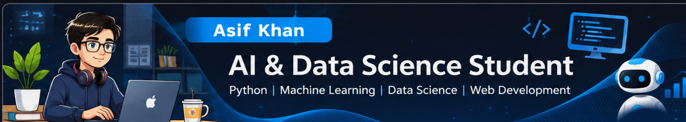

# Hi there, I'm Asif Khan! 👋

# About Me 🚀

I'm a passionate **AI & Data Science Student** with experience in **Python, HTML, CSS, and Machine Learning fundamentals**. I love tackling complex problems, learning new skills, and collaborating with diverse teams to create innovative solutions.

- 🌱 Currently learning: **Artificial Intelligence, Machine Learning, Data Science, Python, and JavaScript**
- 🔭 Working on: **Sky Coffee Website and Python Machine Learning Exercises**
- 🌍 Languages: **Python, HTML, CSS, JavaScript; [human languages you speak]**
- 📫 How to reach me: [**minatoonlinestore01@gmail.com**](mailto\:minatoonlinestore01@gmail.com)
- ⚡ Fun fact: **[a fun fact about yourself]**

## My Skills 

## Featured Projects 💻

### [Project 1 Tit](project_1_link)le

**[Project 1 Title]** is a **[brief project description]** built with **[technologies used]**. This project demonstrates my ability to **[skills demonstrated by the project]**. You can check out the repository [here](project_1_repository_link).

### [Project 2 Title](project_2_link)

**[Project 2 Title]** is a **[brief project description]** built with **[technologies used]**. This project showcases my skills in **[skills demonstrated by the project]**. You can check out the repository [here](project_2_repository_link).

## Get in Touch 📬

- [**Personal Website / Blog**](your_website_or_blog_link)
- [**LinkedIn**](your_linkedin_profile_link)
- [**Twitter**](your_twitter_profile_link)
- **GitHub:** [itsboykhan](https://github.com/itsboykhan)
